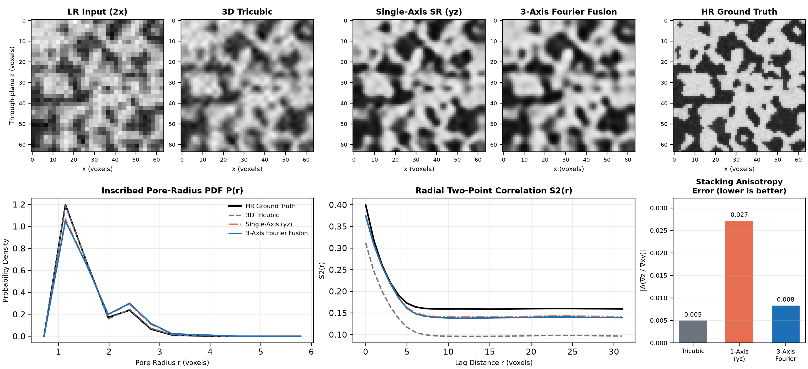

# End-to-End Tutorial

This tutorial walks through a complete reproducible 2D-to-3D super-resolution and petrophysical evaluation cycle in **OpenLSR-X**—from generating a connected 3D synthetic porous volume with realistic tomographic blur and noise, to leakage-free slab splitting, `SRGAN` training, 3-axis orthogonal Fourier fusion, and quantitative pore-space validation.

---

## 1. Run the Self-Contained Walkthrough Script

You can execute the entire tutorial in under 30 seconds on CPU (or seconds on GPU):

```bash
uv run python examples/quickstart_walkthrough.py \
  --volume-size 64 \
  --epochs 6 \
  --output-figure docs/assets/quickstart_overview.png \
  --output-json results/quickstart_metrics.json
```



Notice two key physical behaviors in the output panels above:

1. **Elimination of slice-stacking artifacts:** Applying a 2D generator along a single axis (`yz`) introduces visible horizontal discontinuities in the orthogonal through-plane (`xz`) view, inflating the through-plane gradient anisotropy error $|\Delta(\nabla_z / \nabla_{xy})|$. **3-Axis Orthogonal Fourier Fusion** blends the directional spatial wavevectors across `yz`, `xz`, and `xy` planes to restore isotropic continuity.
2. **Pore-scale structural fidelity:** Inspecting the inscribed pore-radius density $P(r)$ and radial two-point correlation $S_2(r)$ verifies that super-resolution preserves pore-space statistics rather than merely smoothing high-frequency interfaces.

---

## 2. Step-by-Step Python API

```python
import pytorch_lightning as pl
from openlsrx import (
    SRGAN,
    SyntheticPoreSpyDataModule,
    evaluate_image_metrics,
    evaluate_petrophysical_metrics,
    super_resolve_volume_orthogonal,
)

# 1. Leakage-free 3D slab splitting (train / val / test separated by guard slices)
dm = SyntheticPoreSpyDataModule(
    volume_size=64,
    scale_factor=2,
    feature_regime="high_feature",
    noise_regime="high_noise",
    patch_size_lr=16,
    batch_size=8,
    guard_slices_lr=1,
    seed=42,
)
dm.setup()

# 2. Configure compact 2D SRGAN with generator warmup
model = SRGAN(
    adaptive_size=8,
    super_res_factor=2,
    num_blocks=4,
    out_channels=32,
    disc_features=[32, 32, 64, 64],
    pretrain_epochs=3,
    use_vgg_loss=False,
    save_val_images=False,
)

trainer = pl.Trainer(max_epochs=6, logger=False, enable_checkpointing=False)
trainer.fit(model, datamodule=dm)

# 3. Reconstruct isotropic 3D volume via 3-Axis Orthogonal Fourier Fusion
lr_test, hr_test = dm.splits_3d["test"]

ortho = super_resolve_volume_orthogonal(
    model.gen,
    lr_test,
    scale_factor=2,
    axes=("yz", "xz", "xy"),
    fusion="fourier",
)
sr_volume = ortho["fused"]

# 4. Evaluate volumetric fidelity and reference-locked porous-media petrophysics
img_metrics = evaluate_image_metrics(sr_volume, hr_test)
petro_metrics = evaluate_petrophysical_metrics(sr_volume, hr_test, threshold_method="otsu")
print(img_metrics["psnr"], petro_metrics["porosity_abs_error"])
```

---

## 3. Equivalent `openlsrx` CLI Workflow

For YAML-driven reproducible experiments on laboratory TIFF stacks or synchrotron NeXus/HDF5 reconstructions:

```bash
# Train with automatic checkpointing
openlsrx fit -c configs/base/config.yaml

# Reconstruct 3D super-resolved BigTIFF volume (3-axis orthogonal fusion + uncertainty)
openlsrx predict -c configs/base/config.yaml \
  --ckpt_path lightning_logs/version_0/checkpoints/last.ckpt

# Evaluate image + petrophysical metrics against ground truth
openlsrx evaluate \
  --pred outputs/base_run/predicted_orthogonal/base_srgan_predicted_stack.tiff \
  --target outputs/base_run/predicted_orthogonal/base_srgan_high_res_stack.tiff \
  --output outputs/evaluation_report.json
```
