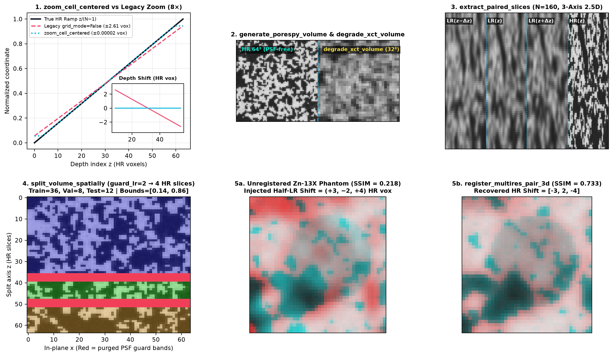
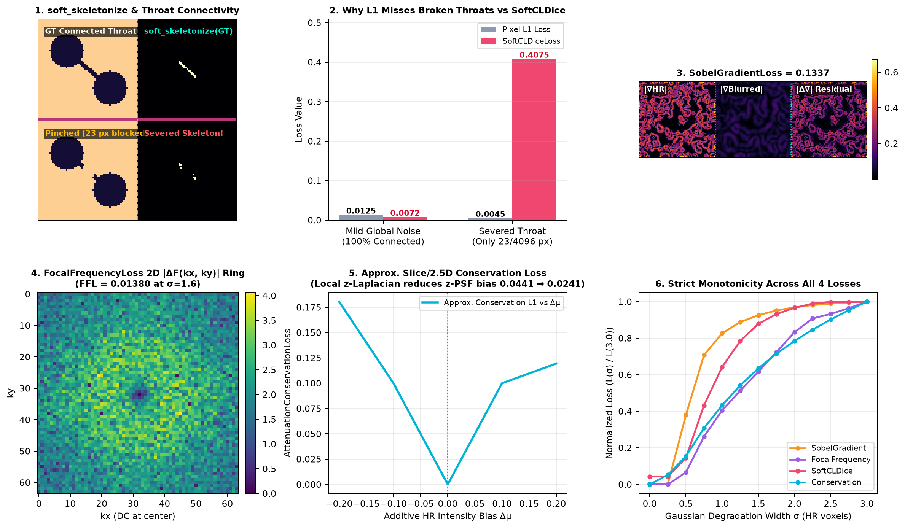
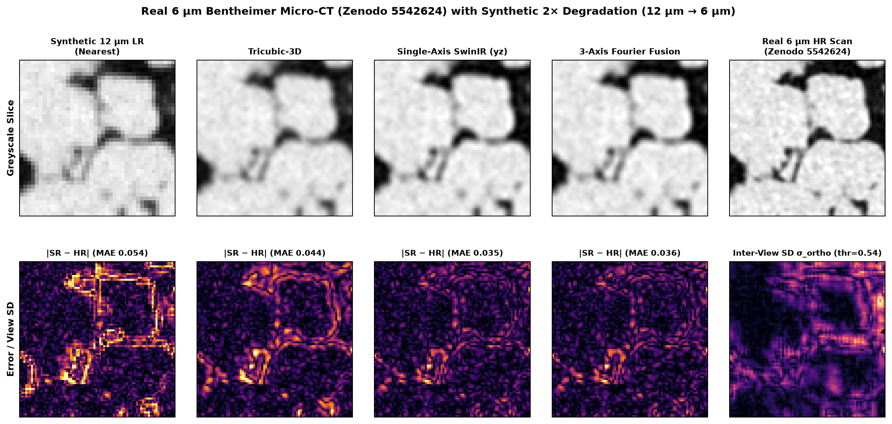

# Analytical & Visual Verification Suite

This page documents the reproducible verification suite included in `scripts/verification/run_verification_suite.py` and enforced in CI via `tests/test_analytical_verification.py`. Each core function in `openlsrx` is checked against **closed-form analytical ground truth**, **explicitly labeled 3D phantoms**, and **real 6 µm Bentheimer Sandstone micro-CT scans (`Zenodo 5542624`) under controlled synthetic 2× degradation**.

To regenerate every figure and the machine-readable report (`docs/assets/verification/verification_summary.json`) locally:

```bash
# Fast closed-form analytical pytest checks (~10 s on CPU)
pytest tests/test_analytical_verification.py

# Full visual + multi-seed Bentheimer verification suite
python scripts/verification/run_verification_suite.py \
  --output-dir docs/assets/verification \
  --include-bentheimer
```

---

## 1. Data Generation, Cell-Centered Alignment, Split Isolation & Registration (`openlsrx.data`)



### 1.1 `zoom_cell_centered` — Eliminating Half-Block Depth Shift

Block-averaging an HR grid of spacing `Δx_HR = 1` by factor `s` places coarse voxel `k` at coordinate `(k + 0.5)*s - 0.5`. Legacy `scipy.ndimage.zoom(..., grid_mode=False)` pins corner voxels (`0` and `N - 1`), introducing a spatially varying depth shift of up to `±(s - 1)/2` HR voxels. `zoom_cell_centered` (`openlsrx.data.transforms`) uses `grid_mode=True` with boundary-preserving `'nearest'` extension so coarse and fine voxel centers remain aligned across `2×`, `4×`, and `8×`.

| Scale Factor `s` | Analytical Corner-Pinned Limit `(s - 1) / 2` | Legacy `grid_mode=False` Max Shift (HR vox) | `zoom_cell_centered` Max Shift (HR vox) |
| :---: | :---: | :---: | :---: |
| `2×` | `0.5000` | `±0.4683` | **`±0.000004`** (`4e-6`) |
| `4×` | `1.5000` | `±1.3095` | **`±0.000008`** (`8e-6`) |
| `8×` | `3.5000` | `±2.6111` | **`±0.000023`** (`2.3e-5`) |

### 1.2 `generate_porespy_volume` and `degrade_xct_volume`

`generate_porespy_volume` synthesizes correlated 3D two-phase porous media (`float32` in `[0, 1]`), and `degrade_xct_volume` applies 3D Gaussian PSF blur, exact `s³` block-averaging, and detector noise (`(64, 64, 64)` HR → `(32, 32, 32)` LR at `scale_factor=2`).

### 1.3 `extract_paired_slices_from_subvolume` and `build_multi_axis_slice_dataset`

Extracts cell-centered `(LR, HR)` slice pairs across `("yz", "xz", "xy")`. In `2.5D` mode (`context_slices = 2k + 1`), neighboring slices are sampled at native coarse-grid spacing (`±Δz_LR`) rather than cubically blended sub-voxel steps, producing `lr_ctx` of shape `(160, 3, 32, 32)` and `hr_slc` of shape `(160, 64, 64)` on a `(16, 32, 32)` LR / `(32, 64, 64)` HR slab.

### 1.4 `minimum_psf_guard_slices_lr`, `split_volume_spatially`, and `compute_normalization_bounds`

Enforces 3D slab isolation by purging `ceil((4 * psf_sigma + 2) / s)` LR slices (`2` LR / `4` HR slices at `psf_sigma=1.0, s=2`) at both `train|val` and `val|test` boundaries (`Train=36`, `Guard=4`, `Val=8`, `Guard=4`, `Test=12` HR slices), and fits percentile normalization bounds (`[0.1360, 0.8566]`) strictly on `train`.

### 1.5 `register_multires_pair_3d` and Provenance-Guarded Loaders

- **Half-LR-voxel 3D shift recovery:** Injecting a `(+3, -2, +4)` HR voxel translation (`+1.5, -1.0, +2.0` LR voxels at `2×`) into a `Zn-13X` phantom pair, `register_multires_pair_3d` recovers the exact `(-3, +2, -4)` HR shift and raises `triplanar_ssim` from `0.2176` to **`0.7330`**.
- **Strict offline provenance:** Calling `prepare_zn13x_benchmark(..., prefer_offline=True)` sets `source_kind = "offline_calibrated_zn13x_phantom"`, `is_experimental_xct = False`, and `low_zenodo_doi = None` / `high_zenodo_doi = None`.

---

## 2. Topology, Gradient, Spectral & Approximate Conservation Losses (`openlsrx.losses`)



### 2.1 `soft_skeletonize` and `SoftCLDiceLoss` — Detecting Severed Pore Throats

Blocking a narrow throat (`23 / 4096` pixels, `0.56%` of slice area) between two pore chambers disconnects flow (`D_eff = 0`) while modifying far fewer pixels than mild uniform noise:

| Perturbation Applied to Ground Truth | Modified Pixels | Pixel `L1` Loss | `SoftCLDiceLoss` | Connectivity |
| :--- | :---: | :---: | :---: | :---: |
| Mild uniform noise (`σ = 0.025`), throat open | `4096 / 4096` (`100%`) | `0.01254` | **`0.00724`** | Connected |
| Severed central throat (`23` pixels blocked) | `23 / 4096` (`0.56%`) | `0.00449` (`2.8×` lower `L1`) | **`0.40745`** (**`56.3×` higher**) | Disconnected |

### 2.2 `AttenuationConservationLoss`, `SobelGradientLoss`, and `FocalFrequencyLoss`

!!! note "Approximate Slice/2.5D Consistency vs. Exact 3D Conservation"
    `AttenuationConservationLoss` operates on 2D HR slice predictions paired with `1`-slice (`2D`) or `3`-slice (`2.5D`) LR inputs; it is therefore an **approximate slice/slab consistency regularizer**, not an exact 3D tomographic conservation constraint. When `2.5D` context (`C >= 3`) is provided, a local discrete `z`-Laplacian term (`L_{z-1} - 2 L_z + L_{z+1}`) reduces second-order through-plane PSF curvature bias on smooth profiles (`0.04412` → `0.02406`, `-45.5%` on a quadratic `z` ramp), whereas exact 3D block-average conservation only holds on full 3D volumes under matched LR/HR intensity calibration.

Across Gaussian blur widths `σ ∈ [0, 3.0]` HR voxels, `SobelGradientLoss`, `FocalFrequencyLoss`, `SoftCLDiceLoss`, and `AttenuationConservationLoss` all evaluate to `0.0` at `σ = 0` and increase strictly monotonically with degradation width.

---

## 3. Baselines, Neural Backbones & Orthogonal Fourier Fusion (`openlsrx.baselines`, `openlsrx.models`, `openlsrx.inference`)

### 3.1 Multi-Backbone Comparison on Synthetic & Calibrated 3D Phantoms (`2×`)


All three datasets in Figure 3 are **synthetic or calibrated 3D phantoms** (`8–10` CPU training epochs on the PSF-guarded `train` slab, evaluated on the unseen `test` slab):

- **Dataset A (`Synthetic PoreSpy 3D Phantom`, `generate_porespy_volume`):** Connected two-phase blobs (`16 × 48 × 48` HR test slab).
- **Dataset B (`Calibrated Indiana Limestone Phantom`, `source_kind="calibrated_carbonate_phantom"`):** Bimodal vuggy carbonate phantom (`PSNR`: `Nearest 20.03 dB` → `Tricubic 21.06 dB` → `SwinIR-2.5D 21.92 dB`).
- **Dataset C (`Calibrated 3-Phase Zn-13X Phantom`, `source_kind="offline_calibrated_zn13x_phantom"`, `is_experimental_xct=False`):** `32³ → 64³` 3-phase phantom (`Tricubic` → `SwinIR-2.5D-3Axis`: `PSNR` `15.46 → 16.63 dB`, 3-phase macro-Dice `0.5576 → 0.6720`, macropore Dice `0.4833 → 0.7557`).

| Method (`Dataset A: Synthetic PoreSpy 3D`) | PSNR (dB) ↑ | 3D Triplanar SSIM ↑ | Pore Dice ↑ | Abs. Porosity Err ↓ | Through-Plane Anisotropy Err ↓ | Optical MTF_0.5 (cyc/vox) ↑ |
| :--- | :---: | :---: | :---: | :---: | :---: | :---: |
| `upsample_3d(..., "nearest")` | `15.19` | `0.6309` | `0.7905` | `0.1122` | `0.0487` | `0.1783` |
| `upsample_3d(..., "tricubic")` | `16.23` | `0.6958` | `0.8231` | `0.1162` | `0.0363` | `0.1910` |
| `SR3DResNet` (Native 3D CNN) | `16.48` | `0.7182` | `0.8134` | `0.1175` | `0.0469` | `0.2042` |
| `SRGAN` (`SRResNet-3Axis`) | `16.41` | `0.7478` | `0.8508` | **`0.0602`** | `0.0899` | `0.2422` |
| `SRGAN` (`RRDB-3Axis`) | **`18.30`** | **`0.8146`** | **`0.8907`** | `0.0689` | `0.0137` | **`0.2687`** |
| `super_resolve_volume_single_axis` (`SwinIR yz`) | `18.22` | `0.8110` | `0.8893` | `0.0715` | `0.0452` | `0.2552` |
| `super_resolve_volume_orthogonal` (`SwinIR-2.5D-3Axis`) | `18.11` | `0.8063` | `0.8858` | `0.0738` | **`0.0029`** (`15.6×` lower) | `0.2565` |

### 3.2 Real `6 µm` Bentheimer Micro-CT (`Zenodo 5542624`) Under Synthetic `2×` Degradation



!!! important "Provenance & Scope of the Bentheimer Verification Check"
    - **Real HR scan, synthetic `2×` LR degradation:** The `6 µm` HR volumes (`Core1_Subvol1_LR.tif` and `Core2_Subvol2_LR.tif`, `Zenodo 5542624`, Jackson et al., 2021 — named `_LR` in their `6 µm → 2 µm` study) are real experimental X-ray micro-CT scans, whereas the `12 µm` LR inputs here are generated via `degrade_xct_volume` (`degrade_from_hr=True`, `psf_sigma=1.0`, `noise_std=0.02`). A `(0, 0, 0)` HR-voxel shift on this pair therefore verifies **zero algorithmic coordinate drift** through synthetic degradation and cell-centered fusion, rather than physical registration of two independent scans.
    - **Sample size & convergence:** The table below reports `mean ± SD` across `3` seeds (`42, 43, 44`) on two distinct `96 × 80 × 80` Bentheimer cores (`22 × 80 × 80` held-out test slabs) after a compact `8`-epoch CPU training budget (`~35 s/run`). Full scientific benchmark claims require full GPU training (`100+` epochs), thicker test slabs, and true dual-scan rocks or electrodes.

| Core (`Zenodo 5542624`, Real `6 µm` HR + Synthetic `2×` LR, `n = 3` seeds) | Tricubic PSNR (dB) | `SwinIR-3Axis` PSNR (dB) | Tricubic `D_eff` Rel. Err (%) | Single-Axis `yz` `D_eff` Rel. Err (%) | `3-Axis` `D_eff` Rel. Err (%) | Voxel `σ_ortho` vs Error Spearman `r_s` | `±1 σ_ortho` Envelope Coverage |
| :--- | :---: | :---: | :---: | :---: | :---: | :---: | :---: |
| `bentheimer_sandstone` (Core 1 Subvol 1, `D_eff = 0.0396`) | `23.48 ± 0.00` | `25.76 ± 0.19` | `17.44 ± 0.40%` | `15.54 ± 0.43%` | **`14.87 ± 0.74%`** | `+0.270 ± 0.010` (weak positive) | `0 / 3` |
| `bentheimer_laminated` (Core 2 Subvol 2, `D_eff = 0.0765`) | `25.00 ± 0.03` | `27.05 ± 0.18` | `6.51 ± 0.14%` | `2.59 ± 1.36%` | **`2.09 ± 1.30%`** | `+0.232 ± 0.006` (weak positive) | `3 / 3` |

Across all `6/6` core-seed runs, `D_eff` relative error decreases monotonically from `Tricubic-3D` → `Single-Axis SwinIR (yz)` → `3-Axis SwinIR-2.5D`, even though `3-Axis` PSNR is `0.1–0.3 dB` lower than single-axis `yz`. Inter-view standard deviation `σ_ortho` (`n = 3` orthogonal sweeps) exhibits a **weak but consistently positive** Spearman rank correlation (`r_s = 0.23–0.27`) with voxelwise error `|SR - HR|`, and its `±1 σ_ortho` threshold shift brackets true `D_eff` in `3/6` short-epoch runs (`0/3` on Core 1 where `8`-epoch bias exceeds `1 σ_ortho`, `3/3` on Core 2, and `1/1` at `12` epochs on a `128 × 96 × 96` Core 1 slab where `D_eff` error drops from `8.92%` Nearest / `4.97%` Tricubic to `1.64%`).

---

## 4. Closed-Form Analytical Verification of Physics & Spectral Metrics (`openlsrx.metrics`, `openlsrx.io`)


### 4.1 `solve_steady_state_diffusion_axis` and `compute_directional_tortuosity`

| Analytical Test Geometry | Porosity `φ` | Exact `D_eff` | Solver `D_eff` | Exact `τ` | Solver `τ` | `solver_converged` | Rel. Error |
| :--- | :---: | :---: | :---: | :---: | :---: | :---: | :---: |
| 1. Open Bulk Space (`32³`) | `1.0000` | `1.000000` | **`0.999999`** | `1.0000` | **`1.0000`** | `True` | **`0.0001%`** |
| 2. Parallel Straight Ducts along `z` | `0.2500` | `0.250000` (`D_x=0`) | **`0.250000`** (`D_x=0`) | `1.0000` | **`1.0000`** | `True` | **`0.0001%`** |
| 3. Straight Trunk + Dead-End Cavity | `0.1266` | `0.06250` (1D trunk) | **`0.06267`** | `2.0260` | **`2.0206`** | `True` | **`0.27%`** |
| 4. Maxwell Insulating Sphere (`R = 6 / 40³`) | `0.9858` | `0.97878` | **`0.97663`** | `1.0071` | **`1.0093`** | `True` | **`0.22%`** |
| 5. Maxwell Insulating Sphere (`R = 9 / 40³`) | `0.9514` | `0.92879` | **`0.92401`** | `1.0243` | **`1.0296`** | `True` | **`0.52%`** |
| 6. Maxwell Insulating Sphere (`R = 11 / 40³`) | `0.9123` | `0.87391` | **`0.86690`** | `1.0439` | **`1.0523`** | `True` | **`0.80%`** |

In Case 3 (`Trunk + Dead-End Cavity`), the attached dead-end cavity carries zero steady-state flux (`∇c = 0` inside the pocket) and inlet/outlet flux conservation holds to **`|J_in - J_out| / J_mean = 2.61e-9`**.

### 4.2 `compute_fsc_3d` — Effective Optical MTF vs. Shell FSC

Convolving a 3D white-noise volume with an isotropic Gaussian PSF yields the exact analytical modulation transfer function `H(k) = exp(-2 * pi^2 * sigma^2 * k^2)` with half-amplitude cutoff `k_0.5 = sqrt(ln(2) / 2) / (pi * sigma)`. Because shell `FSC(k)` normalizes by both shell magnitudes, any positive scalar blur leaves noiseless `FSC(k) == 1`, whereas `effective_mtf` recovers `H(k)` directly:

| Gaussian Blur `σ` (vox) | Exact `k_0.5` (`cyc/vox`) | Measured `cutoff_freq_mtf_050` | Full-Curve `MTF_eff` RMSE | Noiseless Shell `cutoff_freq_050` (`FSC`) |
| :---: | :---: | :---: | :---: | :---: |
| `0.8` | `0.2342` | **`0.2348`** (`0.26%` err) | **`0.00298`** | `0.5000` (insensitive to pure blur) |
| `1.4` | `0.1339` | **`0.1338`** (`0.07%` err) | **`0.00527`** | `0.5000` (insensitive to pure blur) |
| `2.2` | `0.0852` | **`0.0853`** (`0.12%` err) | **`0.01096`** | `0.3904` (triggers only near float floor) |

### 4.3 `compute_euler_density`, `two_point_correlation_radial`, `compute_drainage_curve`, and `export_for_openimpala`

- **3D Euler Characteristic (`compute_euler_density`):** Solid 3D sphere (`R = 10` in `48³`, exact `χ = +1`) measures **`+1.0000`**; solid 3D torus (`R = 12, r = 4.5` in `48³`, exact `χ = 0`) measures **`0.0000`**.
- **Zero-padded non-periodic `S_2(r)` (`two_point_correlation_radial`):** Uncorrelated 3D Bernoulli medium (`φ = 0.2979`) matches exact `S_2(0) = φ = 0.2979` and `S_2(r >= 1) = φ^2 = 0.0888` with **`RMSE = 0.00030`**.
- **Capillary drainage (`compute_drainage_curve`):** Parallel cylindrical tubes (`R_1 = 3`, `R_2 = 7` voxels) exhibit sharp saturation steps at exact Young–Laplace entry proxies `2 / R_2 = 0.286` and `2 / R_1 = 0.667`.
- **OpenImpala export (`export_for_openimpala`):** Writes a verified `uint8` 3D multi-page TIFF (`98,890` bytes) and companion AMReX `.inputs` deck (`eb2.geom_type = "tiff"`, `torteff.phase = 1`, `torteff.direction = "z"`).
